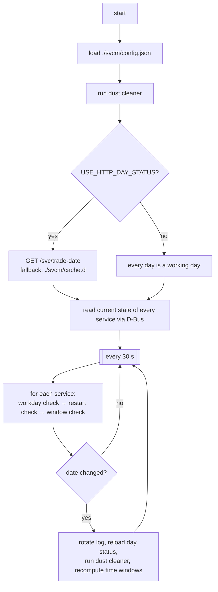
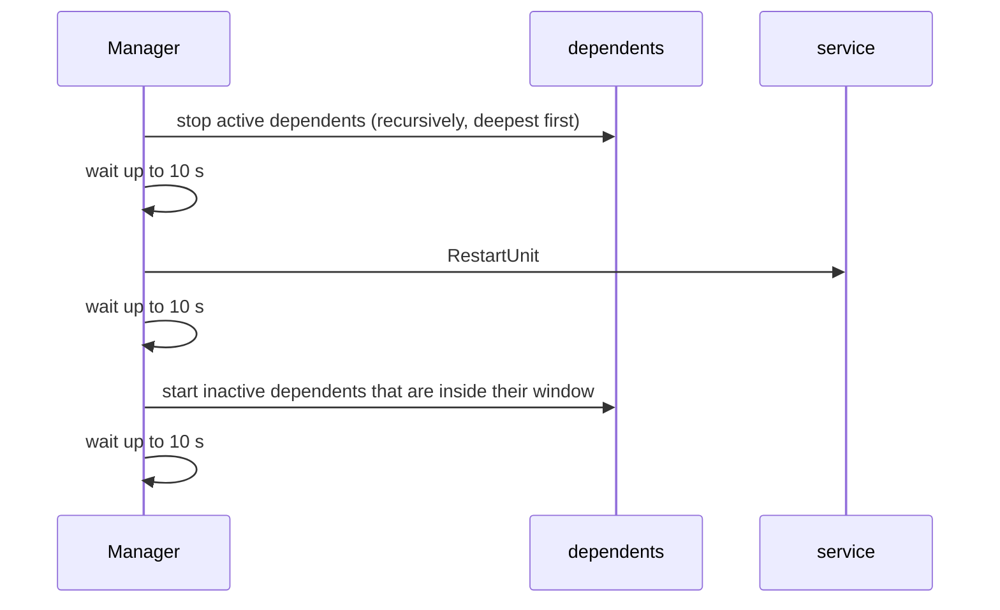

# Linux Service Manager

A small, single-binary C++20 daemon that **keeps systemd services running on a schedule**. It talks to systemd over D-Bus (via [sdbus-c++](https://github.com/Kistler-Group/sdbus-cpp)) and, every 30 seconds, makes sure each configured service is running when it should be and stopped when it should not be.

It was extracted from a trading-engine deployment, which explains two optional features: a *working-day* check (is today a trading day?) and a *dust cleaner* that prunes old logs and caches.

**Version:** 4.0.1.1 · **Language:** C++20 · **Platform:** Linux with systemd · **Executable:** `service_manager`

---

## Table of contents

1. [Features](#features)
2. [How it works](#how-it-works)
3. [Requirements](#requirements)
4. [Building](#building)
5. [Directory layout at runtime](#directory-layout-at-runtime)
6. [Configuration reference](#configuration-reference)
7. [Running](#running)
8. [Behaviour in detail](#behaviour-in-detail)
9. [Working-day server contract](#working-day-server-contract)
10. [Logging](#logging)
11. [Test / diagnostic build](#test--diagnostic-build)
12. [Source code map](#source-code-map)
13. [Known limitations](#known-limitations)
14. [Troubleshooting](#troubleshooting)
15. [License](#license)

---

## Features

| Feature | What it does |
|---|---|
| **Scheduled start/stop** | Each service has a daily `start`–`end` window. The service is started inside the window and stopped outside it. |
| **Always-on mode** | `00:00:00` for `start` or `end` means "no window": the service is kept running all day. |
| **Auto-heal** | If a service inside its window is found inactive, it is started again. |
| **Daily scheduled restart** | Optional `restart` time. The service is restarted once per day in a ±60 s window. |
| **Dependency-aware restart** | Services listed in `dependent` are stopped before the parent restarts and started again afterwards. |
| **Working-day gating** | `required_workday: true` services are only run on working days. Day status comes from an HTTP endpoint (optional compile-time feature) with an on-disk cache fallback. |
| **Dust cleaner** | Deletes files older than 5 days by extension, optionally limited to `/cache/` paths, and optionally removes empty directories. Runs at startup and every new day. |
| **Daily log rotation** | One log file per day under `./svcm/log/`, capped at 40 MB. Log lines also go to stdout. |
| **Graceful shutdown** | `SIGINT`, `SIGTERM` and `SIGABRT` stop the loop cleanly and flush logs. |

---

## How it works



All service control goes through systemd's D-Bus API (`org.freedesktop.systemd1`):

| Action | D-Bus method |
|---|---|
| start | `Manager.StartUnit(name, "replace")` |
| stop | `Manager.StopUnit(name, "replace")` |
| restart | `Manager.RestartUnit(name, "replace")` |
| status | `Manager.LoadUnit(name)` → read `Unit.ActiveState` |

`LoadUnit` is used rather than `GetUnit` so that status also works for units that have never been started or were garbage-collected by systemd.

---

## Requirements

**Runtime**

- Linux with systemd.
- Permission to control units on the **system bus** (normally run as `root`).
- `libsystemd` (and `libsdbus-c++` if you do not link it statically).

**Build**

- C++20 compiler (GCC or Clang) and CMake ≥ 3.12.
- `libsystemd-dev` (linked as `systemd`).
- [`nlohmann/json`](https://github.com/nlohmann/json) headers in `/usr/include` or `/usr/local/include` (`nlohmann/json.hpp`).
- **sdbus-c++ 2.x, built as a static library**. `CMakeLists.txt` requires both of these paths to exist, otherwise configuration fails:
  - `/usr/local/lib/libsdbus-c++.a`
  - `/usr/local/include/sdbus-c++`

Example for Debian/Ubuntu (package names may differ on other distributions):

```bash
sudo apt install build-essential cmake git pkg-config libsystemd-dev nlohmann-json3-dev

# sdbus-c++ as a static library installed under /usr/local
git clone https://github.com/Kistler-Group/sdbus-cpp.git
cd sdbus-cpp
cmake -S . -B build -DCMAKE_BUILD_TYPE=Release -DBUILD_SHARED_LIBS=OFF
cmake --build build -j"$(nproc)"
sudo cmake --install build
```

---

## Building

```bash
git clone https://github.com/rajibchy/linux-service-manager.git
cd linux-service-manager
mkdir build && cd build
cmake -DCMAKE_BUILD_TYPE=Release ..
make -j"$(nproc)"
```

### CMake options

| Option | Default | Meaning |
|---|---|---|
| `CMAKE_BUILD_TYPE` | *(empty)* | Pass `Release` (`-O3 -DNDEBUG`) or `Debug` (`-g -O0`). It is also part of the output path. |
| `USE_HTTP_DAY_STATUS` | `ON` | Compile in the HTTP working-day check. When `OFF`, every day is treated as a working day and the `http` config section is not read. |
| `USE_PRODUCTION_BUILD` | `ON` | `ON` builds the real daemon (`service.cpp`). `OFF` builds the [test tool](#test--diagnostic-build) instead. |

`build.linux.sh` shows the author's typical invocations, for example a Release build without the HTTP feature:

```bash
cmake -DCMAKE_BUILD_TYPE=Release -DUSE_HTTP_DAY_STATUS=OFF ..
```

### Where the binary goes

The output directory is set relative to the **parent** of the source tree:

```
<repo>/../output/service_manager/bin/<CMAKE_BUILD_TYPE>/service_manager
```

`make install` installs to that same path (it is the `RUNTIME DESTINATION`). Copy the binary wherever you want to run it from, e.g. `/opt/service-manager/`.

---

## Directory layout at runtime

All runtime files are resolved **relative to the current working directory** of the process. Start the binary from the directory that contains `svcm/`.

```
/opt/service-manager/            ← working directory
├── service_manager              ← the binary
└── svcm/
    ├── config.json              ← required, you create this
    ├── cache.d                  ← auto-created (HTTP mode): "<today>~<trade-date>"
    └── log/
        └── 2026_11_06.log       ← one file per day, auto-created
```

> The `config.json` in the repository root is a **sample**. Copy it to `./svcm/config.json`.

---

## Configuration reference

The file `./svcm/config.json` must be a JSON object with up to three sections.

```json
{
  "http": { "server": "127.0.0.1", "port": 9100 },

  "svc": [
    {
      "name": "nginx",
      "start": "00:00:00",
      "end": "00:00:00",
      "restart": "00:06:00",
      "required_workday": false,
      "dependent": ["web_app"]
    }
  ],

  "dust": [
    { "ext": [".log", ".seq"] },
    { "ext": [".json"], "is_cache": true },
    { "ext": [".log"], "dir": "/home/service/app", "delete_empty_dir": true }
  ]
}
```

### `http` (object)

Required **only** when built with `USE_HTTP_DAY_STATUS=ON`. Ignored otherwise.

| Key | Type | Notes |
|---|---|---|
| `server` | string | Host name or IPv4 address of the day-status server. |
| `port` | number | Must not be `0`, `443` (HTTPS is not supported) or ≥ `65535`. |

### `svc` (array, required)

One object per managed service.

| Key | Type | Required | Description |
|---|---|---|---|
| `name` | string | yes | systemd unit name. If it contains no `.`, `.service` is appended (`nginx` → `nginx.service`). Other unit types need the full name (e.g. `backup.timer`). |
| `start` | string `HH:MM:SS` | yes | Start of the daily window (local time). |
| `end` | string `HH:MM:SS` | yes | End of the daily window (local time, inclusive). |
| `restart` | string `HH:MM:SS` | no | Time of the daily restart. Omit, or use `00:00:00`, to disable. |
| `required_workday` | boolean | yes | If `true`, the service only runs on working days. |
| `dependent` | array of strings | no | Services to stop before, and start after, this service is restarted. Each must also appear as its own entry in `svc`. |

**Time rules**

- Times are 24-hour `HH:MM:SS` in the system's **local time zone**.
- If `start` or `end` is empty or `00:00:00`, the service has **no window** and is treated as always-on ("uninterrupted mode").
- A window must **not cross midnight** (`start` must be earlier than `end`). See [limitations](#known-limitations).

### `dust` (array, optional)

Each object describes one cleanup rule.

| Key | Type | Default | Description |
|---|---|---|---|
| `ext` | array of strings | *(none)* | Extensions to match, **including the dot** (`".log"`). A rule with no `ext` does nothing. |
| `dir` | string | current working directory | Root directory, scanned recursively. |
| `is_cache` | boolean | `false` | When `true`, only files whose path contains `/cache/` are considered. |
| `delete_empty_dir` | boolean | `false` | After deleting files, remove empty sub-directories under `dir` (the root itself is kept). |

A file is deleted when its last-write time is **5 days or more** in the past. The age limit is fixed in the code.

> ⚠️ **Be careful with rules that omit `dir`.** They scan the working directory recursively. That is what lets the first sample rule rotate old logs in `./svcm/log/`, but it will also delete any other matching old file below the working directory.

### Config errors

A missing or invalid mandatory key stops start-up with a message such as
`config->svc->[index]->start (string) time not found at ./svcm/config.json`, and the process exits with a failure code.

---

## Running

The daemon runs in the foreground and blocks until it receives a signal.

```bash
cd /opt/service-manager
sudo ./service_manager
# Initializing "Service Manager"
# Press Ctrl+C to exit...
```

Exit codes: `0` on a clean shutdown; `1` if the logger cannot be opened, the config fails to load, or the main loop fails (for example, the day status could not be loaded from either the server or the cache).

### Run it as a systemd service

The manager does not daemonise itself. Run it under systemd. This unit is an **example**, it is not shipped in the repository:

```ini
# /etc/systemd/system/service-manager.service
[Unit]
Description=Linux Service Manager
After=network-online.target dbus.service
Wants=network-online.target

[Service]
Type=simple
WorkingDirectory=/opt/service-manager
ExecStart=/opt/service-manager/service_manager
Restart=on-failure
RestartSec=5
User=root

[Install]
WantedBy=multi-user.target
```

```bash
sudo systemctl daemon-reload
sudo systemctl enable --now service-manager
```

Stopping the manager does **not** stop the services it manages. They stay in whatever state they are in.

---

## Behaviour in detail

### The monitor loop

At start-up the manager reads each service's current state. Then, **every 30 seconds**, for each service in config order:

1. **Working-day gate.** If `required_workday` is `true` and today is not a working day, the service is stopped if it was active, and no further rules are applied to it.
2. **Scheduled restart.** If a `restart` time is set, the service has not already been restarted today, and the current time is within 60 seconds after the restart time → run the [restart sequence](#restart-sequence).
3. **Inside the window.** If the current time is in `[start, end]` (or the service has no window) and it is found inactive → start it. This is the auto-heal step.
4. **Outside the window.** If the service is tracked as active → stop it.

Active states that count as running are `active` and `activating`. Everything else, including `failed`, `deactivating`, a missing unit, or a D-Bus error, counts as inactive (D-Bus errors are logged).

### Restart sequence



A service is restarted at most once per day. The flag is reset when the date changes.

### Day change

When the local date changes, the manager:

1. renews (rotates) the log file,
2. reloads the working-day status (HTTP mode),
3. runs the dust cleaner,
4. recomputes every service's time window for the new date and resets the "restarted today" flags,
5. re-reads each service's current state.

### Working-day status

| Build | Behaviour |
|---|---|
| `USE_HTTP_DAY_STATUS=OFF` | Every day is a working day. |
| `USE_HTTP_DAY_STATUS=ON` | Asks the server for the trade date and compares it with today's date (see the [contract](#working-day-server-contract)). Up to **10 attempts**, waiting 1 s, 2 s, 3 s … between failures. If all fail, falls back to `./svcm/cache.d`. If there is no valid cache from **today**, start-up (or the day change) fails. |

### Dust cleaner

Runs at start-up and on each new day, only if `dust` is non-empty. For each rule and each extension it recursively walks the directory, deletes matching regular files that are at least 5 days old, then optionally prunes empty directories. Every deletion and error is logged.

---

## Working-day server contract

Only relevant with `USE_HTTP_DAY_STATUS=ON`. The server must be reachable over plain HTTP/1.1 (no TLS, IPv4 only).

```
GET /svc/trade-date HTTP/1.1
Host: <server>
Connection: close
User-Agent: fsys-http-client/1.0
X-Req-From: service
```

The response **body** must be a single date in `YYYY-MM-DD` form (a real calendar date, leap years are checked):

```
2026-11-06
```

- If the date equals **today** → today is a working day.
- If it is a different date → today is **not** a working day, and the returned value is the next working day (it is logged).
- Anything else (empty body, wrong format) counts as a failed attempt and is retried.

On success the manager writes `./svcm/cache.d` as `<today>~<trade-date>` (e.g. `2026-11-06~2026-11-08`). The cache is only trusted if the stored "today" matches the current date.

---

## Logging

- File: `./svcm/log/YYYY_MM_DD.log` (appended; a new file each day). The directory is created if missing.
- Every line is also printed to stdout, so `journalctl -u service-manager` shows the same output when run under systemd.
- Format: `HH:MM:SS.mmm<TAB>LEVEL<TAB>message`
- Levels: `INFO`, `DEBUG`, and **`FATAL`** (used for all error messages).
- A file stops growing at **40 MB** and `MAX_SIZE_EXCCEDED` is written once (stdout output continues).

```text
-----------------------------------------------------------------
This Log generated at 2026-11-06 00:00:01 for Service Manager 4.0.1.1
-----------------------------------------------------------------
00:00:01.120	INFO	Preparing "Service Manager"
00:00:01.134	INFO	Starting "Service Manager" with 30 sec delay monitor; Total Service: 2
00:00:31.140	INFO	"nginx.service" status inactive. We've to start.
00:00:31.141	INFO	Starting service: "nginx.service"
```

---

## Test / diagnostic build

Building with `-DUSE_PRODUCTION_BUILD=OFF` compiles `src/service-test.cpp` instead of the daemon. It is a one-shot CLI for checking D-Bus access:

```bash
./service_manager <start|stop|restart|status> <service-name>
./service_manager status nginx
```

Before acting on the service it performs an HTTP GET against a hard-coded host (`snm.fsys.tech:80`) and exits with an error if that fails, so it needs `USE_HTTP_DAY_STATUS=ON` and network access. It also requires at least two arguments.

---

## Source code map

| File | Responsibility |
|---|---|
| `src/service.cpp` | `main()`: signal handling, `prepare()` → `block()` lifecycle (production build). |
| `src/service-test.cpp` | `main()` for the diagnostic CLI (non-production build). |
| `src/handler.cpp`, `include/svc/handler.h` | `service_handler_t`: the monitor loop, restart / dependency orchestration, day-change handling, working-day logic, cache file. |
| `src/manager.cpp`, `include/svc/manager.h` | `service_manager_t`: systemd D-Bus wrapper (`start`, `stop`, `restart`, `get_status`). Returns `1` on success and `-1` on failure; the last error is available via `get_last_error()`. |
| `src/config.cpp`, `include/svc/config.h` | `svc_config` struct and `_load_config()`: parses and validates `./svcm/config.json`. |
| `src/json-config.cpp`, `include/svc/json-config.h` | `json_config_t`: thin typed wrapper over nlohmann/json. |
| `src/time-range.cpp`, `include/svc/time-range.h` | `time_range_t` (window and restart maths on epoch values) plus date helpers `_get_current_date()` and `_is_valid_date()`. |
| `src/dust-cleaner.cpp`, `include/svc/dust-cleaner.h` | `dust_cleaner_t` and `dust_clean_config`: old-file and empty-directory cleanup. |
| `src/logger.cpp`, `include/svc/logger.h` | `svc_logger`: daily file logger with variadic `info/debug/error`. |
| `src/http.cpp`, `src/httpc.cpp`, `include/svc/http.h`, `include/svc/httpc.h` | Minimal POSIX-socket HTTP/1.1 GET client (`http_client`). Compiled only with `USE_HTTP_DAY_STATUS`. |
| `CMakeLists.txt` | Build definition, options, dependency checks. |
| `build.linux.sh` | Example build commands. |
| `config.json` | Sample configuration. |

---

## Known limitations

These are properties of the current code, not bugs in your setup.

- **No overnight windows.** `start` later than `end` (e.g. `22:00:00`–`06:00:00`) is never "inside" the window, so the service will not run. Split it into two entries or use always-on mode.
- **Restart suppresses a dependent's own restart that day.** Dependents toggled during a parent's restart are marked as "restarted" for the day.
- **Dependents must be configured.** A name in `dependent` that has no matching `svc` entry is logged as `not found` and skipped (the sample `config.json` references `web_app` without defining it).
- **State is tracked, not continuously reconciled.** The "outside the window → stop" rule acts on the manager's recorded state, which is refreshed at start-up and on day change. A service started by hand outside its window may be left running if the manager thinks it is inactive.
- **No hot reload.** Configuration is read once at start-up. Restart the manager after editing `config.json`.
- **HTTP day-status is plain HTTP over IPv4 only.** No TLS, no IPv6, no redirects.
- **Fixed constants.** Loop interval (30 s), dependency wait (10 s), restart tolerance (60 s), dust age (5 days) and log cap (40 MB) are compile-time values.
- **Linux/systemd only.** The CMake file has Windows branches, but sdbus-c++ is not available there, so the daemon is not usable on Windows.

---

## Troubleshooting

| Symptom | Likely cause / fix |
|---|---|
| CMake: `sdbus-c++ static library or include path not found!` | Install sdbus-c++ as a **static** library into `/usr/local` (see [Requirements](#requirements)). |
| CMake: `nlohmann/json.hpp not found!` | Install `nlohmann-json3-dev`, or place the headers under `/usr/include` or `/usr/local/include`. |
| `Unable to open config file` | `./svcm/config.json` not found. Check the working directory. |
| `config->…not found at ./svcm/config.json` | A required key is missing; the message names it. |
| `D-Bus error: … Access denied` in the log | Not running as root, or no polkit/D-Bus permission to manage units. |
| `Failed to load day status for …` and exit | HTTP server unreachable and no cache from today (HTTP build). Fix the server, or build with `-DUSE_HTTP_DAY_STATUS=OFF`. |
| Service never starts | Check the window (`start` < `end`, local time), `required_workday` vs. today's status, and the `.service` name. |
| Dust cleaner deleted unexpected files | A rule without `dir` scans the working directory recursively. Add an explicit `dir`. |

---

## License

`LICENSE` in this repository is the **MIT License** (© 2025 Rajib Chowdhury).

## Contributing

Issues and pull requests are welcome. Please keep changes small and describe how you tested them against a real systemd host.