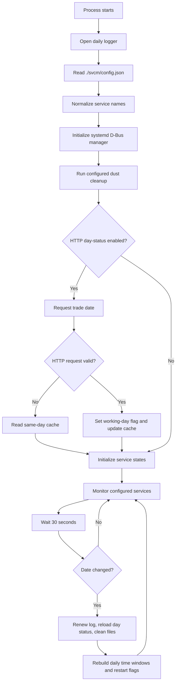

# Linux Service Manager

A lightweight Linux daemon written in C++20 that supervises a configured set of **systemd services** according to daily operating windows, optional working-day rules, and scheduled restart times.

The manager communicates with systemd through the system D-Bus using `sdbus-c++`. It periodically checks configured units, starts services that should be running, stops services that should be offline, and can restart a service together with its configured dependents.

The project also includes two operational features that can be enabled through configuration/build options:

- **Working-day gating** — obtain a trade/working date from an HTTP endpoint, with a same-day cache fallback.
- **Dust cleaning** — remove selected old files and optionally prune empty directories.

| Property | Value |
|---|---|
| Project | Linux Service Manager |
| Version in CMake | `4.0.1.1` |
| Language standard | C++20 |
| Runtime | Linux with systemd |
| Service control | systemd D-Bus (`org.freedesktop.systemd1`) |
| Configuration | JSON |
| Executable | `service_manager` |
| License | MIT |

> The repository's root `config.json` is an example. At runtime the program reads `./svcm/config.json` relative to its **working directory**.

## Contents

- [Capabilities](#capabilities)
- [Architecture and execution flow](#architecture-and-execution-flow)
- [Service lifecycle and monitoring](#service-lifecycle-and-monitoring)
- [Scheduling rules](#scheduling-rules)
- [Dependent services](#dependent-services)
- [Working-day mode](#working-day-mode)
- [Dust cleaner](#dust-cleaner)
- [Configuration](#configuration)
- [Build requirements](#build-requirements)
- [Build](#build)
- [Deploy and run](#deploy-and-run)
- [Logs](#logs)
- [Diagnostic build](#diagnostic-build)
- [Source layout](#source-layout)
- [Operational notes and current limitations](#operational-notes-and-current-limitations)
- [Troubleshooting](#troubleshooting)
- [License](#license)

## Capabilities

| Capability | Implemented behavior |
|---|---|
| Scheduled service operation | Each configured service has a daily `start` and `end` time. The manager starts it while the current local time is in the configured window and stops it outside that window. |
| Unrestricted operation | If either `start` or `end` is empty or `00:00:00`, the time range is disabled and the service is treated as eligible all day. |
| Periodic monitoring | The manager checks configured services on a 30-second loop. |
| Automatic recovery | While a service is eligible to run, a service reported as inactive/failed is started again on the next monitoring cycle. |
| Scheduled daily restart | An optional `restart` time triggers a restart once per local calendar day, within the implementation's 60-second matching interval. |
| Dependent-service handling | During a scheduled restart, configured dependents are stopped recursively before the parent restart and eligible inactive dependents are started afterwards. |
| Working-day restriction | `required_workday: true` prevents a service from running when the configured working-day source says the current date is not a working day. |
| HTTP working-day lookup | Optional compile-time feature that requests `/svc/trade-date` from a configured HTTP host and port. |
| Working-day cache | A successful HTTP result is stored in `./svcm/cache.d` and can be used as a fallback for the same local date. |
| Old-file cleanup | Configured file extensions can be removed when their last-write time is at least five days old. |
| Cache-path filtering | A dust-cleaning rule can restrict deletion to paths containing `/cache/`. |
| Empty-directory cleanup | A dust-cleaning rule can recursively remove empty subdirectories after file deletion. |
| Daily log files | Logs are written to `./svcm/log/YYYY_MM_DD.log` and also printed to standard output. |
| Signal handling | The production executable registers handlers for `SIGINT`, `SIGTERM`, and `SIGABRT` and signals the monitor loop to exit. |

## Architecture and execution flow

The application has three main responsibilities:

1. **Configuration and policy** — load service schedules, dependent-service names, working-day requirements, and cleanup rules from JSON.
2. **Orchestration** — decide which configured services should be running at the current local time and coordinate scheduled restarts.
3. **Systemd integration** — issue start, stop, restart, and status operations through the system D-Bus.



### systemd D-Bus operations

The service manager uses the systemd manager object at:

- Bus name: `org.freedesktop.systemd1`
- Object path: `/org/freedesktop/systemd1`
- Manager interface: `org.freedesktop.systemd1.Manager`
- Unit interface: `org.freedesktop.systemd1.Unit`

| Operation | D-Bus call / property |
|---|---|
| Start | `StartUnit(service_name, "replace")` |
| Stop | `StopUnit(service_name, "replace")` |
| Restart | `RestartUnit(service_name, "replace")` |
| Read state | `LoadUnit(service_name)`, then read `ActiveState` |

The status implementation uses `LoadUnit`, which asks systemd to load/resolve a unit before reading its `ActiveState`. The manager does not implement process supervision itself; systemd remains responsible for the actual unit lifecycle, process execution, and any unit-level restart policy.

A service name without a period is normalized by appending `.service`. A name that already contains a period is left unchanged.

## Service lifecycle and monitoring

### Startup

The production process performs the following preparation steps:

1. Opens the logger.
2. Reads `./svcm/config.json`.
3. Loads the `svc` array and optional `dust` rules.
4. Normalizes configured service names and dependent-service names.
5. Creates the system-bus service manager.
6. Runs dust cleanup when at least one dust rule is configured.
7. Loads working-day status when `USE_HTTP_DAY_STATUS` is enabled.
8. Queries the current systemd state of each configured service.
9. Enters the monitoring loop.

If configuration loading or logger initialization fails, startup fails. In HTTP mode, failure to obtain a valid working-day value from both the HTTP endpoint and the cache also prevents the monitor loop from starting.

### Monitoring interval

The monitoring loop uses a 30-second interval. Each pass evaluates services in the same order in which they appear in the `svc` configuration array.

For each service, the manager applies these checks:

1. **Working-day requirement.** If `required_workday` is true and the current date is not a working day, an active service is stopped and the remaining checks for that service are skipped.
2. **Scheduled restart.** If a restart time is configured and the service has not already been marked restarted for the day, the manager checks whether the current time is within the restart interval. If so, it performs the restart sequence.
3. **Inside the operating window.** If the service is eligible to run and its current systemd state is not considered active, the manager issues `StartUnit`.
4. **Outside the operating window.** If the manager's recorded state says the service is active, it issues `StopUnit`.

The monitoring loop is a policy/watchdog loop for the services listed in `svc`; it does not enumerate or supervise every systemd unit on the host.

### Status interpretation

The handler maps systemd `ActiveState` values into a simplified active/inactive state:

| systemd `ActiveState` | Handler interpretation |
|---|---|
| `active` | Active |
| `activating` | Active |
| `deactivating` | Inactive |
| `inactive` | Inactive |
| `failed` | Inactive |
| Other values, including `reloading` | Inactive |
| Status lookup error | Inactive; error is logged |

The simplified `service_state::ERROR` enum value is declared but the current status-mapping path returns either `ACTIVE` or `INACTIVE`.

### Automatic recovery

When a configured service is inside its operating window (or has no time restriction), the manager queries its current state. If the state is not interpreted as active, it issues a start request.

This behavior is repeated on subsequent monitor cycles. There is no retry counter, exponential backoff, or retry limit in this watchdog path. systemd's own unit-level start limits still apply.

A recovery start is a plain start operation. It does **not** run the scheduled-restart dependency stop/start sequence.

## Scheduling rules

### Time format

The `start`, `end`, and `restart` fields use local 24-hour time in this format:

```text
HH:MM:SS
```

Examples:

```text
08:30:00
17:45:00
00:00:00
```

The implementation converts configured times to local `time_t` values for the current date. At a date change it prepares the time values again for the new local date.

### Operating window

The service is considered inside its operating window when:

```text
start_epoch <= current_time <= end_epoch
```

Both boundaries are inclusive.

If either `start` or `end` is empty or equals `00:00:00`, both internal window boundaries are set to zero. A zero boundary means there is no time restriction.

Examples:

| `start` | `end` | Effective behavior |
|---|---|---|
| `08:00:00` | `17:00:00` | Eligible from 08:00:00 through 17:00:00 |
| `00:00:00` | `00:00:00` | Eligible all day |
| `08:00:00` | `00:00:00` | Eligible all day |
| `00:00:00` | `17:00:00` | Eligible all day |
| `22:00:00` | `06:00:00` | Not supported as an overnight window |

**Important:** `00:00:00` is a sentinel for an unrestricted schedule, not a midnight boundary. The current implementation does not support overnight windows or multiple windows per service.

### Scheduled restart

A non-empty `restart` value other than `00:00:00` enables daily restart handling.

- The monitor checks the restart time on each loop pass.
- A restart is eligible when `now` is greater than or equal to the configured time and no later than 60 seconds after it.
- The service is marked as restarted as soon as the restart is attempted, whether or not the D-Bus call succeeded. A failed restart is logged and is **not** retried that day.
- The daily restart flag is reset when the local date changes.
- A service whose restart time is missed by more than 60 seconds will not be restarted later that day.

The restart interval is a fixed 60 seconds in the current source code.

## Dependent services

The `dependent` array identifies other configured services associated with a service. The current implementation uses this relationship during the **scheduled restart** sequence.

For a scheduled restart of a parent service:

1. Each named dependent is looked up in the configured `svc` list.
2. Active dependents are stopped.
3. The dependent's own dependents are processed recursively before that dependent is stopped.
4. The manager waits between orchestration stages.
5. The parent receives a systemd restart request.
6. Inactive dependents whose own schedules currently allow them to run are started again.
7. Their dependent services are processed recursively.

This produces a stop order from the deepest configured dependent toward the parent, followed by a start sequence beginning with the direct dependent.

### Dependency configuration example

```json
{
  "svc": [
    {
      "name": "api",
      "start": "00:00:00",
      "end": "00:00:00",
      "restart": "03:00:00",
      "required_workday": false,
      "dependent": ["worker"]
    },
    {
      "name": "worker",
      "start": "00:00:00",
      "end": "00:00:00",
      "restart": "00:00:00",
      "required_workday": false,
      "dependent": ["scheduler"]
    },
    {
      "name": "scheduler",
      "start": "00:00:00",
      "end": "00:00:00",
      "restart": "00:00:00",
      "required_workday": false,
      "dependent": []
    }
  ]
}
```

All dependent names should have corresponding entries in `svc`. A dependent name that cannot be found is logged and skipped.

The implementation does not build or validate a dependency graph at configuration load time. Avoid circular dependency definitions. The dependency list is an orchestration relationship; it does not replace systemd unit dependencies such as `Requires=`, `Wants=`, or `After=`.

A dependent service that is toggled during a parent's scheduled restart is also marked as restarted for the day. Consequently, its own scheduled restart may be suppressed later that day.

## Working-day mode

Working-day support is controlled at compile time by `USE_HTTP_DAY_STATUS`.

### Build modes

| Build option | Working-day behavior |
|---|---|
| `USE_HTTP_DAY_STATUS=ON` | The manager retrieves a trade date from an HTTP endpoint and uses it to determine whether today is a working day. |
| `USE_HTTP_DAY_STATUS=OFF` | `_is_working_day` is initialized to `true`; every calendar day is treated as a working day. The `http` configuration section is not required. |

When HTTP mode is enabled, the configuration must contain:

```json
{
  "http": {
    "server": "127.0.0.1",
    "port": 9100
  }
}
```

The manager sends a GET request to:

```http
GET /svc/trade-date HTTP/1.1
Host: 127.0.0.1
Connection: close
User-Agent: fsys-http-client/1.0
X-Req-From: service
```

The response body must contain a valid calendar date in `YYYY-MM-DD` format, without additional text.

Example:

```text
2026-11-06
```

The date is interpreted as follows:

- Returned date equals today's local date: today is a working day.
- Returned date differs from today's local date: today is not a working day; the returned date is logged as the next working date.

The HTTP client is a small POSIX socket implementation. It uses IPv4 (`AF_INET`) and plain HTTP; it does not implement TLS, redirects, HTTP status-code validation, or a general-purpose HTTP response parser.

### Retry and cache behavior

The HTTP lookup is attempted up to 10 times. After a failed connection/read, empty body, or invalid date, the manager waits for an increasing number of seconds: 1, 2, 3, and so on, before retrying.

If all HTTP attempts fail during startup, the manager tries the local cache:

```text
./svcm/cache.d
```

The cache format is:

```text
YYYY-MM-DD~YYYY-MM-DD
```

The first date is the local date on which the cache was written. The second date is the returned trade date.

Example:

```text
2026-11-06~2026-11-08
```

The cache is accepted only if:

- both dates are valid calendar dates; and
- the first date matches the current local date.

A cache from a previous date is rejected. A successful HTTP lookup updates the cache.

The cache fallback is used **only at startup**. At a date change there is no fallback: if the HTTP lookup fails all 10 attempts, the monitor loop ends and the process exits with a failure code. Under `Restart=on-failure` the restarted process then needs either a reachable endpoint or a cache written *today*, which a day-old cache is not.

### `required_workday`

Set `required_workday` to `true` for a service that should run only on a working day:

```json
{
  "name": "market-worker",
  "start": "08:45:00",
  "end": "16:00:00",
  "restart": "00:00:00",
  "required_workday": true,
  "dependent": []
}
```

When today is not a working day, the handler stops the service if its recorded state is active and skips the remaining scheduling/restart checks for that service.

## Dust cleaner

The dust cleaner is configured through the optional `dust` array. It runs:

- during startup preparation; and
- when the local calendar date changes.

Each rule describes a directory scan and a list of filename extensions to remove.

A file is eligible for deletion when:

- it is a regular file;
- its extension exactly matches one of the configured extensions; and
- its **last-write time** is at least five days old.

The implementation uses last-write time, not file creation time.

### Dust rule fields

| Field | Type | Default / behavior |
|---|---|---|
| `dir` | string | If omitted or empty, the current working directory is used. |
| `ext` | array of strings | Extensions to match, including the leading dot, e.g. `.log`. An empty list performs no cleanup for that rule. |
| `is_cache` | boolean | Defaults to `false`. When `true`, only paths containing `/cache/` are considered. |
| `delete_empty_dir` | boolean | Defaults to `false`. When `true`, empty subdirectories are recursively removed after file cleanup. |

### Example

```json
{
  "dust": [
    {
      "dir": "/var/log/my-application",
      "ext": [".log", ".seq"],
      "is_cache": false,
      "delete_empty_dir": true
    },
    {
      "dir": "/var/lib/my-application",
      "ext": [".json"],
      "is_cache": true,
      "delete_empty_dir": false
    }
  ]
}
```

The `is_cache` filter checks whether the full path string contains the literal `/cache/` segment. It is not a general cache-directory discovery mechanism.

**Use explicit directories.** If `dir` is omitted, cleanup starts at the process working directory and recursively traverses it. Review the configured paths and extensions carefully before enabling cleanup. Deletion is permanent; there is no dry-run mode in the current implementation.

## Configuration

The manager reads this file:

```text
./svcm/config.json
```

The root must be a JSON object. The `svc` array is required. The `http` object is required only when `USE_HTTP_DAY_STATUS=ON`. The `dust` array is optional.

### Complete example

```json
{
  "http": {
    "server": "127.0.0.1",
    "port": 9100
  },
  "svc": [
    {
      "name": "nginx",
      "start": "00:00:00",
      "end": "00:00:00",
      "restart": "00:06:00",
      "required_workday": false,
      "dependent": ["web-app"]
    },
    {
      "name": "redis",
      "start": "00:00:00",
      "end": "00:00:00",
      "restart": "00:04:00",
      "required_workday": false,
      "dependent": []
    },
    {
      "name": "market-worker",
      "start": "08:45:00",
      "end": "16:00:00",
      "restart": "00:00:00",
      "required_workday": true,
      "dependent": []
    },
    {
      "name": "web-app",
      "start": "00:00:00",
      "end": "00:00:00",
      "restart": "00:00:00",
      "required_workday": false,
      "dependent": []
    }
  ],
  "dust": [
    {
      "dir": "/var/log/my-application",
      "ext": [".log", ".seq"],
      "is_cache": false,
      "delete_empty_dir": true
    },
    {
      "dir": "/var/lib/my-application",
      "ext": [".json"],
      "is_cache": true,
      "delete_empty_dir": false
    }
  ]
}
```

Remove the `http` object when building with `USE_HTTP_DAY_STATUS=OFF`.

### Service fields

| Field | Required | Type | Description |
|---|---:|---|---|
| `name` | Yes | string | systemd unit name. `.service` is appended if the name contains no period. |
| `start` | Yes | string | Daily start time in `HH:MM:SS`. |
| `end` | Yes | string | Daily end time in `HH:MM:SS`. |
| `restart` | No | string | Daily scheduled restart time. Missing value disables scheduled restart. |
| `required_workday` | Yes | boolean | If true, the service is eligible only when today is a working day. |
| `dependent` | No | array of strings | Names of other services in `svc` to coordinate around this service's scheduled restart. |

The loader requires `name`, `start`, `end`, and `required_workday`. `restart` and `dependent` are optional. A missing `dependent` list is treated as no configured dependents.

### HTTP fields

| Field | Required in HTTP mode | Type | Description |
|---|---:|---|---|
| `server` | Yes | string | Hostname or IPv4 address of the working-day endpoint. |
| `port` | Yes | integer | TCP port. Port `443`, `0`, and values greater than or equal to `65535` are rejected by the configuration loader. |

The HTTP client uses plain HTTP. Do not configure port 443 expecting HTTPS.

### Runtime directory

All runtime paths are relative to the process working directory, not the executable's location:

```text
/opt/service-manager/
├── service_manager
└── svcm/
    ├── config.json
    ├── cache.d
    └── log/
        └── YYYY_MM_DD.log
```

Create `svcm/config.json` before starting the manager. The logger creates the log directory when needed. The working-day cache is created when a successful HTTP lookup is saved.

## Build requirements

### Runtime requirements

- Linux distribution using systemd.
- Access to the system D-Bus and permission to manage the target systemd units.
- `libsystemd` runtime library.
- `sdbus-c++` runtime library if the executable is linked dynamically. The repository's CMake configuration explicitly links a static `libsdbus-c++.a` from `/usr/local/lib`.

The manager generally needs elevated privileges or an appropriate system D-Bus/polkit policy to control system services.

### Build requirements

- CMake 3.12 or newer.
- C++20-capable GCC or Clang.
- `libsystemd` development files.
- `nlohmann/json.hpp` available under `/usr/include` or `/usr/local/include`.
- `sdbus-c++` development headers and a static library installed at the paths expected by this repository:
  - `/usr/local/include/sdbus-c++`
  - `/usr/local/lib/libsdbus-c++.a`

On Debian/Ubuntu, the system packages include:

```bash
sudo apt update
sudo apt install build-essential cmake pkg-config libsystemd-dev nlohmann-json3-dev
```

The exact `sdbus-c++` build/install procedure depends on the version and distribution. Ensure its static library and headers are installed at the paths above before configuring this project.

## Build

Clone the repository and configure a Release build:

```bash
git clone https://github.com/rajibchy/linux-service-manager.git
cd linux-service-manager

cmake -S . -B build \
  -DCMAKE_BUILD_TYPE=Release \
  -DUSE_PRODUCTION_BUILD=ON \
  -DUSE_HTTP_DAY_STATUS=OFF

cmake --build build --parallel
```

To enable the HTTP working-day feature:

```bash
cmake -S . -B build-http \
  -DCMAKE_BUILD_TYPE=Release \
  -DUSE_PRODUCTION_BUILD=ON \
  -DUSE_HTTP_DAY_STATUS=ON

cmake --build build-http --parallel
```

### CMake options

| Option | Default | Description |
|---|---|---|
| `CMAKE_BUILD_TYPE` | Not set by project | Use `Release` or `Debug`. Release uses `-O3 -DNDEBUG`; Debug uses `-g -O0`. |
| `USE_PRODUCTION_BUILD` | `ON` | Builds the production daemon entry point when enabled; otherwise compiles the diagnostic/test entry point. |
| `USE_HTTP_DAY_STATUS` | `ON` | Enables the HTTP working-day lookup and cache logic. When disabled, all days are treated as working days. |

### Binary output

The CMake file sets the runtime output directory to:

```text
<parent-of-repository>/output/service_manager/bin/<CMAKE_BUILD_TYPE>/
```

For example, a Release executable is placed at:

```text
../output/service_manager/bin/Release/service_manager
```

The `install` target uses the same runtime output directory as its install destination. This is a project-specific output location, not a conventional `/usr/bin` installation.

## Deploy and run

### 1. Prepare the runtime directory

Choose a stable working directory. For example:

```bash
sudo mkdir -p /opt/service-manager/svcm
sudo cp ../output/service_manager/bin/Release/service_manager /opt/service-manager/
sudo cp config.json /opt/service-manager/svcm/config.json
```

Edit `/opt/service-manager/svcm/config.json` for the target host. Use absolute paths in dust rules to avoid accidentally scanning an unintended directory.

### 2. Run manually

```bash
cd /opt/service-manager
sudo ./service_manager
```

The current production executable accepts no documented command-line options. It starts the manager, prepares configuration, and enters the monitor loop. Press `Ctrl+C` to request shutdown.

### 3. Run under systemd

Create a unit such as `/etc/systemd/system/linux-service-manager.service`:

```ini
[Unit]
Description=Linux Service Manager
After= dbus.service
Wants=dbus.service

[Service]
Type=simple
WorkingDirectory=/opt/service-manager
ExecStart=/opt/service-manager/service_manager
Restart=on-failure
RestartSec=5
User=root

[Install]
WantedBy=multi-user.target
```

Then load and start it:

```bash
sudo systemctl daemon-reload
sudo systemctl enable --now linux-service-manager.service
sudo systemctl status linux-service-manager.service
```

View console output with:

```bash
sudo journalctl -u linux-service-manager.service -f
```

The manager's own file logs are stored under `/opt/service-manager/svcm/log/` when the `WorkingDirectory` above is used.

> Stopping the manager does not issue stop requests for every service it manages. Managed services remain in their current systemd state.

## Logs

The logger writes to:

```text
./svcm/log/YYYY_MM_DD.log
```

The directory is created if it does not exist. Each date uses a separate file, and the logger appends to an existing file for that date.

### Log format

```text
HH:MM:SS.mmm<TAB>LEVEL<TAB>message
```

Levels emitted by the logger:

| Level | Meaning |
|---|---|
| `INFO` | General operation and lifecycle messages. |
| `DEBUG` | Detailed operational messages, including schedule and status preparation. |
| `FATAL` | Used by the `error()` logging method for error messages. |

Every log message is also written to standard output. This makes the same messages available through `journalctl` when the manager runs as a systemd unit.

The log file has a fixed 40 MB write limit. Once the limit is reached, the logger writes a `MAX_SIZE_EXCCEDED` marker and stops appending further content to that file; standard-output logging continues. The logger changes to the new date's file when the local date changes.

## Diagnostic build

Set `USE_PRODUCTION_BUILD=OFF` to compile `src/service-test.cpp` instead of the production daemon entry point.

The diagnostic executable is intended to exercise the systemd service-manager wrapper using one of these actions:

```text
service_manager <start|stop|restart|status> <service-name>
```

Examples:

```bash
./service_manager status nginx
./service_manager start nginx.service
./service_manager restart redis
./service_manager stop nginx
```

The test entry point normalizes names without a period by appending `.service`. The status action logs the returned `ActiveState`.

**Current source caveat:** `service-test.cpp` also performs a GET request to the hard-coded host `snm.fsys.tech:80` before processing the command. It therefore has an external network dependency, and as written it only compiles with `USE_HTTP_DAY_STATUS=ON` because `http_client` is used unconditionally. The test source's argument check also checks for fewer than two arguments while it subsequently reads `argv[2]`; provide both the action and service name. This target is a development utility, not a polished administrative CLI.

## Source layout

| Path | Responsibility |
|---|---|
| `src/service.cpp` | Production `main()`, signal registration, handler initialization, and monitor lifecycle. |
| `src/service-test.cpp` | Diagnostic/test entry point for direct systemd operations. |
| `src/handler.cpp` | Main orchestration: configuration preparation, working-day retrieval/cache, monitoring loop, service recovery, dependent restart sequence, and date-change handling. |
| `include/svc/handler.h` | `service_handler_t` declaration and orchestration interfaces. |
| `src/manager.cpp` | systemd D-Bus calls for start, stop, restart, and status. |
| `include/svc/manager.h` | `service_manager_t` declaration. |
| `src/config.cpp` | Reads `./svcm/config.json` and creates service and dust-cleaner configuration objects. |
| `include/svc/config.h` | Service configuration structure and state enumeration. |
| `src/json-config.cpp` | JSON file loading and typed JSON access wrapper implementation. |
| `include/svc/json-config.h` | `json_config_t` interface. |
| `src/time-range.cpp` | Local date/time conversion, operating-window evaluation, restart-time evaluation, and date validation. |
| `include/svc/time-range.h` | `time_range_t` declaration and date helper declarations. |
| `src/dust-cleaner.cpp` | Recursive old-file cleanup, cache-path filtering, and empty-directory removal. |
| `include/svc/dust-cleaner.h` | Dust-cleaner configuration and class declarations. |
| `src/logger.cpp` | Daily log file creation, formatting, output, size cap, and daily renewal. |
| `include/svc/logger.h` | Logger interface and variadic message formatting. |
| `src/http.cpp`, `src/httpc.cpp` | Optional POSIX-socket HTTP GET client used for working-day lookup. |
| `include/svc/http.h`, `include/svc/httpc.h` | HTTP helper and client declarations. |
| `CMakeLists.txt` | Build target, compiler standard, dependencies, build options, and output/install paths. |
| `build.linux.sh` | Example build commands used by the project. |
| `config.json` | Sample runtime configuration; copy it to `svcm/config.json`. |
| `LICENSE` | MIT license. |

## Operational notes and current limitations

The following points describe the current source behavior and should be considered when deploying the manager.

### Scheduling and time

- All schedule calculations use the host's local timezone.
- There is one daily start/end window per service.
- Overnight windows are not supported.
- `00:00:00` is a sentinel that disables the entire start/end window when used for either boundary.
- The scheduled restart check has a 60-second post-time interval. If the monitoring loop does not evaluate the service during that interval, the restart is missed for that day.
- Time strings are parsed using `std::get_time`; the configuration loader does not provide a separate comprehensive validation/reporting layer for every time value.

### Monitoring and state

- Only services declared in `svc` are monitored.
- The loop runs every 30 seconds, but dependency orchestration and HTTP retries can add delays.
- The handler's state is a simplified active/inactive value, not the full systemd state model.
- Outside-window stop decisions use the handler's recorded `service.state`; the handler refreshes this state at startup and on date change and updates it after its own successful control requests. A service manually started outside its window after the last state refresh may not be stopped immediately if the handler's recorded state remains inactive.
- A D-Bus status lookup error is logged and treated as inactive by the handler. If the service is eligible to run, the watchdog may then attempt to start it.
- Automatic recovery uses repeated start requests at the normal monitor interval. It does not implement backoff or a maximum retry count.
- systemd unit settings such as `Restart=`, `StartLimitIntervalSec=`, and `StartLimitBurst=` remain independently applicable.

### Dependencies

- Dependent-service names must match entries in the `svc` array after `.service` normalization.
- Missing dependents are logged and skipped.
- Circular dependencies are not detected or rejected during configuration loading.
- The dependency orchestration is used for scheduled restarts; a normal watchdog recovery does not restart the dependency tree.
- A dependent toggled as part of a parent restart is marked as restarted for the day.

### Working-day HTTP client

- HTTP mode uses plain HTTP over IPv4 TCP sockets.
- There is no TLS, redirect handling, configurable request path, HTTP status validation, or general HTTP client feature set.
- The endpoint must return the date as the response body in the expected format.
- The working-day endpoint should be available before manager startup when HTTP mode is enabled, unless a valid same-day cache is present.
- The cache is only trusted for the local date on which it was written.

### Dust cleaner

- Cleanup is recursive and destructive.
- The file age is based on last-write time and is fixed at five days.
- Extensions are matched exactly.
- `is_cache` is a literal path-substring filter for `/cache/`.
- There is no dry-run mode, per-rule age, exclusion list, or cleanup scheduling independent of startup/day change.
- A rule without `dir` defaults to the process working directory.

### Process lifecycle and deployment

- Configuration is loaded at startup; there is no live configuration reload.
- The manager's graceful-exit path signals the monitor loop and flushes/closes logging during object cleanup. It does not stop all managed services.
- The production signal handler invokes logging and handler shutdown logic from the signal handler. In strict POSIX terms, C++ logging, allocation, and synchronization operations are not async-signal-safe; deployments requiring hardened signal handling should address this in the implementation.
- The CMake file contains some Windows conditionals, but the service manager depends on Linux systemd D-Bus and is intended for Linux hosts.

## Troubleshooting

| Symptom | Likely cause / action |
|---|---|
| `Unable to open config file` | The process cannot find `./svcm/config.json`. Check `WorkingDirectory` and file permissions. |
| `config->svc (Array) config not found` | The required `svc` array is missing or has the wrong JSON type. |
| Missing `name`, `start`, `end`, or `required_workday` error | A required service property is absent. Check spelling and JSON types. |
| `sdbus-c++ static library or include path not found!` | Install the static sdbus-c++ library and headers at the paths required by `CMakeLists.txt`. |
| `nlohmann/json.hpp not found!` | Install the JSON development headers or place them in a searched include directory. |
| D-Bus access denied | Run with suitable privileges or configure an appropriate system D-Bus/polkit policy. |
| `Failed to load day status` | In HTTP mode, check host/port reachability and the response body. If the endpoint is unavailable, ensure a valid cache for today's local date exists. |
| A working-day-only service is stopped | Check `required_workday` and the returned trade date. |
| A service does not start at the expected time | Check local timezone, `start`/`end` values, the `00:00:00` sentinel behavior, and whether today is a working day. |
| A scheduled restart did not happen | Check whether the monitor evaluated the service within 60 seconds after the configured restart time and whether it was already marked restarted that day. |
| A service repeatedly receives start requests | The watchdog is retrying because systemd does not report the unit as active. Inspect the unit logs and systemd start limits. |
| A dependent service is not toggled | Confirm that the dependent is also declared in `svc` and that its own time window allows it to start. |
| Unexpected files were removed | Review dust rules, especially `dir`, `ext`, and `is_cache`. A missing `dir` means the process working directory is scanned recursively. |
| Logs are not where expected | Logs are relative to the process working directory: `./svcm/log/`. Check the systemd unit's `WorkingDirectory`. |

Useful systemd diagnostics:

```bash
sudo systemctl status nginx.service
sudo journalctl -u nginx.service -n 100 --no-pager
sudo systemctl show nginx.service -p ActiveState -p SubState
sudo systemctl reset-failed nginx.service
```

## License

This project is distributed under the [MIT License](LICENSE).

Copyright (c) 2025 Rajib Chowdhury.